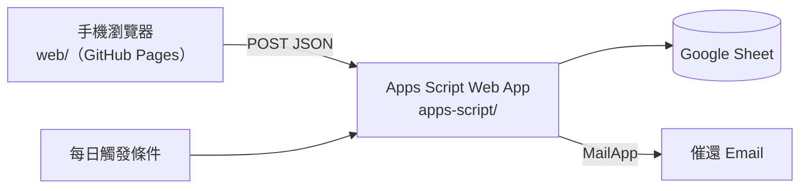

# Sample Inventory System

智慧庫存與展品借還管理系統：像「餐廳掃碼點餐」一樣的手機網頁，掃描展品 QR Code 就能借用、歸還，並自動寄信催還。

## 功能

| 需求 | 做法 |
|---|---|
| 免安裝 App | 手機相機掃描展品 QR Code（內容是 `網址?item=A31`），直接開啟網頁 |
| 購物車式連續掃描 | 借用／歸還清單存在手機瀏覽器，頁面內也能開相機連續掃描多件 |
| 借用表單 | Email（可設定網域只填前綴）、借用事由、預計歸還日期 |
| 管理者代填 | 管理者登入後送出的借用會記錄為「管理者(姓名)代填」，借用人仍是實際借用者 |
| 分批歸還 | 借用紀錄按件獨立，歸還部分展品時其餘繼續掛在借用者名下 |
| 移轉 | 管理者可將借出中的展品移轉到新借用單（例：日本展完直接帶去美國） |
| 自動催還 | 每天定時檢查，超過預計歸還日（10/9 到期，10/10 起逾期）就寄信給借用者 |
| 異動履歷 | 借出、部分歸還、完全歸還、送修、移轉、催還都寫入 Logs，可查單品完整履歷 |
| QR 標籤 | 管理頁面可勾選展品並列印 QR Code 標籤 |

## 架構



- **前端** `web/`：純 HTML／CSS／JavaScript，不需要建置工具，由 GitHub Actions 部署到 GitHub Pages（HTTPS，手機才能開相機）。
- **後端** `apps-script/`：綁定在 Google Sheet 上的 Apps Script，部署成 Web App 當 JSON API；也負責每日催還信，寄件者是部署的 Google 帳號。
- **資料**：Google Sheet 的五張工作表（見下方）。
- **示範模式**：`web/js/config.js` 的 `API_URL` 留空時，或在 localhost 預覽時，前端會在瀏覽器裡直接執行 `apps-script/*.gs`（搭配模擬的 Google 服務），資料只存在該裝置，不會動到正式資料。

```
apps-script/        Apps Script 後端（Config、Db、Items、Loans、Notify、Setup、Code）
web/                手機前端（index.html 借還、labels.html 列印標籤）
web/js/demo/        示範模式：模擬 Google 服務並載入 apps-script 程式
tests/              後端自動化測試（瀏覽器執行）
tools/serve.ps1     本機預覽用的靜態伺服器
.github/workflows/  GitHub Pages 部署
```

## Google Sheet 資料表

執行 `setup()` 會自動建立。程式依標題列名稱讀寫，可以自行調整欄位順序或在右側加欄位。

| 工作表 | 用途 | 主要欄位 |
|---|---|---|
| Items | 展品主檔 | item_id, name, category, location, status（在庫／借出／送修／遺失／報廢）, current_borrower_*, expected_return_date |
| Loans | 借用紀錄，**一件一列** | loan_id（借用單號）, item_id, borrower_email, reason, expected_return_date, status（借出中／已歸還／已移轉）, returned_at, reminder_count |
| Logs | 異動日誌（Raw Log） | timestamp, action, item_id, loan_id, borrower_email, operator, detail |
| Borrowers | 常用借用者（管理者代填的下拉選單） | email, name, last_used_at |
| Settings | 系統設定 | REASONS, EMAIL_DOMAIN, ADMIN_EMAILS, REMINDER_HOUR, APP_URL |

## 部署

### 1. 後端（Google Sheet + Apps Script）

1. 以專案用的 Google 帳號登入，建立一個新的 Google 試算表。
2. 「擴充功能 → Apps Script」，把 `apps-script/` 內每個 `.gs` 檔建立成同名檔案並貼上內容；在「專案設定」勾選「在編輯器中顯示 appsscript.json」後，貼上 `appsscript.json`。
3. 在編輯器選擇函式 `setup` 執行，依提示授權。完成後試算表會出現五張工作表，並建立每日催還排程。
4. 執行 `showAdminKey`，在執行紀錄中取得**管理者金鑰**（不要提交到 Git）。
5. 「部署 → 新增部署作業 → 網頁應用程式」：執行身分「我」、存取權「所有人」，部署後複製網址（`https://script.google.com/macros/s/…/exec`）。

### 2. 前端（GitHub Pages）

1. 把 Web App 網址填入 `web/js/config.js` 的 `API_URL` 並推送到 `main`。
2. GitHub repo 的「Settings → Pages → Source」選 **GitHub Actions**，之後每次推送都會自動部署。
3. 網址為 `https://<帳號>.github.io/sample-inventory-system/`，把它填入試算表 Settings 的 `APP_URL`（會附在催還信中）。
4. 在管理頁面登入後，到「列印 QR 標籤」列印並貼到展品上。

> 修改 Apps Script 後要「部署 → 管理部署作業 → 編輯 → 新版本」，網址不變。

## 本機開發與測試

不需要安裝 Node.js 或 Python：

```bash
powershell -NoProfile -ExecutionPolicy Bypass -File tools/serve.ps1
```

- 前端（示範模式）：http://localhost:8080/web/ ，管理者金鑰 `demo`
- 後端測試：http://localhost:8080/tests/ ，在瀏覽器中以模擬的 Google 服務執行 `apps-script/*.gs`

## 安全性說明

- 這個 repo 是**公開**的：管理者金鑰、試算表 ID、密碼都不可以寫進程式碼，金鑰只存在 Apps Script 的指令碼屬性。
- Web App 存取權為「所有人」以降低借用門檻；寫入動作有鎖定，管理功能需要管理者金鑰。
- 一般使用者的查詢只會看到借用者姓名，借用者 Email 名單與單品履歷僅限管理者。
